# annotated-papers

**Six landmark deep-learning papers, each re-implemented in one readable file with the paper's equations cited by number next to the code, and each put on trial: one small ablation per paper that tests its central claim on a laptop.**

Reading a paper tells you what the authors claim. Implementing it tells you whether you understood it. Running an ablation shows how much of the claim survives at small scale. This repo does all three for Adam, BatchNorm, ResNet, VAE, GAN and DDPM. Every number below was produced by the code in this repo on one Apple M-series laptop, in about 40 minutes of total compute.

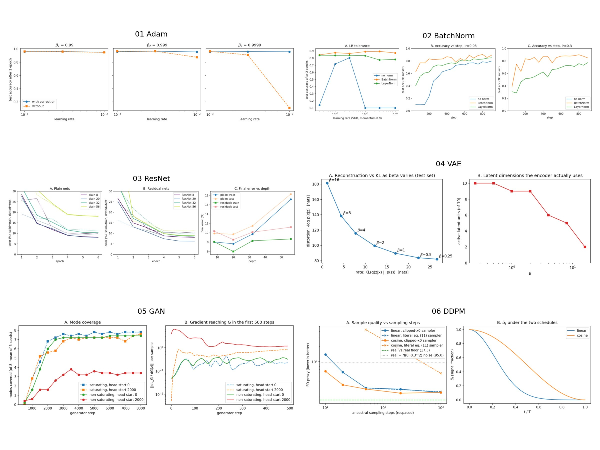

## Reading map

The papers depend on each other. Read them in this order:

```
01 Adam ──────────────┐  (the optimiser every later experiment uses;
                      │   also explains a GAN result in 05)
02 BatchNorm / LN ────┼──> 03 ResNet          (residual blocks are conv-BN-ReLU)
                      │
                      └──> 04 VAE ──> 05 GAN ──> 06 DDPM
                           (latent-variable   (adversarial    (a hierarchy of VAE-like
                            ELBO, reparam.)    generation)     denoisers; ELBO again)
```

1. **Adam** first: it is the optimiser for papers 04-06, and its scale-invariance turns out to explain the GAN result.
2. **BatchNorm** next: ResNet's blocks are built from it, and its train/eval split is a classic bug.
3. **ResNet**: depth only pays off once normalisation *and* shortcuts are in place.
4. **VAE**: the ELBO and the reparameterisation trick. DDPM's training loss is a reweighted ELBO, so this is the conceptual parent of 06.
5. **GAN**: the other generative family, one that never writes down a likelihood.
6. **DDPM**: borrows the VAE's variational bound and a U-Net, and ends up beating GANs on sample quality.

## Results

| # | Paper | Year | Code | Central claim tested | What our ablation found |
|---|---|---|---|---|---|
| 01 | Adam (Kingma & Ba) | 2014 | [`01_adam/model.py`](01_adam/model.py) | Bias correction prevents oversized early steps when beta2 is close to 1 | **Holds where it matters:** at beta2 = 0.9999 and lr = 1e-2, 95.8% vs 11.0% test acc with vs without correction. At default settings, skipping it was *slightly better* (97.8 vs 97.2%). |
| 02 | Batch Normalization (Ioffe & Szegedy) | 2015 | [`02_batchnorm/model.py`](02_batchnorm/model.py) | BN allows much higher learning rates and trains faster | **Holds:** no-norm trains only at lr 0.01-0.03. BN reaches at least 85% at every lr from 0.01 to 1.0. LN trails BN by 0.5-12 points on a ConvNet. The eval-mode bug: 89.2% drops to 15.2% on class-sorted batches |
| 03 | ResNet (He et al.) | 2015 | [`03_resnet/model.py`](03_resnet/model.py) | Deeper plain nets get higher *training* error; shortcuts fix it | **Holds:** plain train err 7.7 / 9.7 / 17.2% at depth 20 / 32 / 56. Residual stays at 6.0 / 8.3 / 8.7% |
| 04 | VAE (Kingma & Welling) + beta-VAE | 2013 / 2017 | [`04_vae/model.py`](04_vae/model.py) | beta trades reconstruction for a more compressed, factorised code | **Holds:** going from beta 0.25 to 16 cuts KL from 26.6 to 1.1 nats, raises reconstruction NLL from 82 to 182 nats, and drops active units from 10 to 2 |
| 05 | GAN (Goodfellow et al.) | 2014 | [`05_gan/model.py`](05_gan/model.py) | The non-saturating G loss avoids vanishing gradients early in training | **Mechanism holds** (saturating gradient is about 500x smaller under SGD). **Outcome flips under Adam:** with a strong D, non-saturating collapses to 3.4/8 modes while saturating covers 7.4/8 |
| 06 | DDPM (Ho et al.) + cosine schedule | 2020 / 2021 | [`06_ddpm/model.py`](06_ddpm/model.py) | eps-prediction + ancestral sampling gives good samples; the cosine schedule degrades more gracefully with fewer steps | **Holds at few steps:** FD-proxy at 10 steps is 64 (cosine) vs 139 (linear), and the two are tied at 1000 steps (24.5 vs 24.4; real-data floor 17.3) |

All headline numbers are collected in one file, [`results/summary.csv`](results/summary.csv) (paper, metric, value, note). Each paper folder also has a `results/results.json` with the raw numbers and a `NOTES.md` covering *what the paper claims, what we found, and where they disagree and why*.

### 01 Adam: bias correction is insurance, not a speed-up
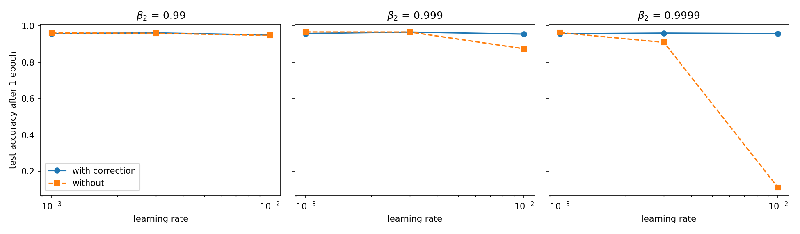

| Optimiser (MNIST MLP, 3 epochs, best of 3 LRs) | Test acc | Noisy quadratic f (cond. 1e3) |
|---|---|---|
| Adam | 0.972 | 0.094 |
| Adam, no bias correction | **0.978** | **0.085** |
| RMSProp | 0.964 | 0.093 |
| SGD + momentum | 0.971 | 0.436 |

Our Adam matches `torch.optim.Adam` to 9e-7 after 200 steps. Without correction, early steps are up to 5.2x larger than with it, close to the 6.6x closed-form peak (1-b1^t)/sqrt(1-b2^t) from section 3 ([figure](01_adam/figures/adam_ablation.png)). That extra step size is harmless, even useful, at beta2 = 0.99-0.999. At beta2 = 0.9999 with lr 1e-2 the early steps blow up and kill the network, which is exactly the regime the paper warns about. [Notes](01_adam/NOTES.md).

### 02 BatchNorm: the LR claim holds, and the eval-mode bug is quiet until it isn't
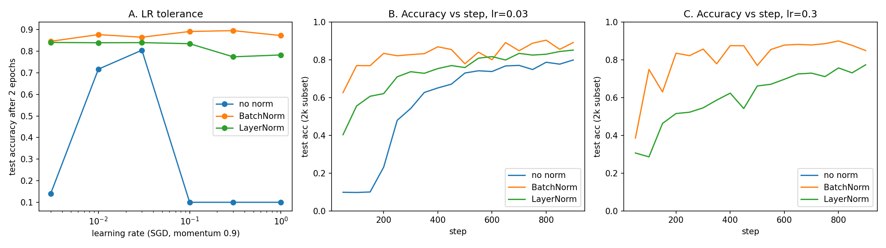
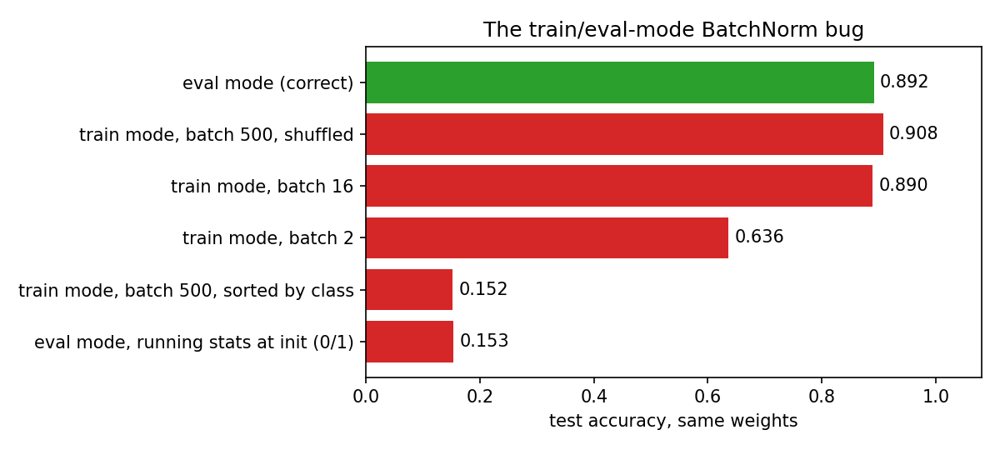

Forgetting `model.eval()` costs nothing with big shuffled batches (90.8%, even slightly above eval mode). It costs 25 points at batch size 2, and 74 points when a batch holds a single class. Running statistics left at their initial values do just as badly (15.4%). [Notes](02_batchnorm/NOTES.md).

### 03 ResNet: degradation reproduced at depth 56
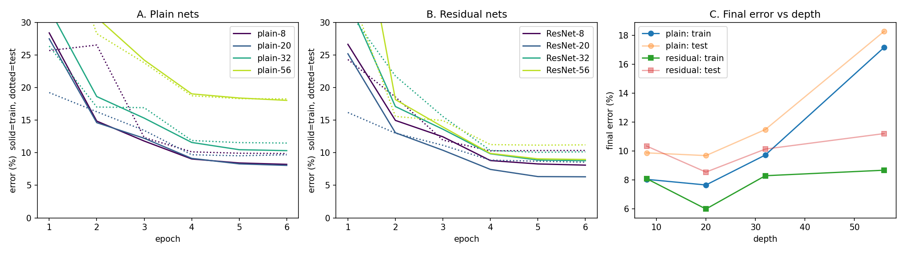

| Depth | Plain train / test err | Residual train / test err |
|---|---|---|
| 8 | 8.05 / 9.88% | 8.10 / 10.35% |
| 20 | 7.66 / 9.69% | **6.00 / 8.55%** |
| 32 | 9.73 / 11.49% | 8.30 / 10.14% |
| 56 | 17.16 / 18.27% | 8.68 / 11.21% |

At initialisation, the plain-56 net's per-block gradient norms span a factor of 916 from first to last block. With shortcuts the span is 4x ([figure](03_resnet/figures/grad_norms_init.png)). The disagreement with the paper: in a 6-epoch budget, ResNet-56 does not beat ResNet-20. [Notes](03_resnet/NOTES.md).

### 04 VAE: a rate-distortion curve in seven points
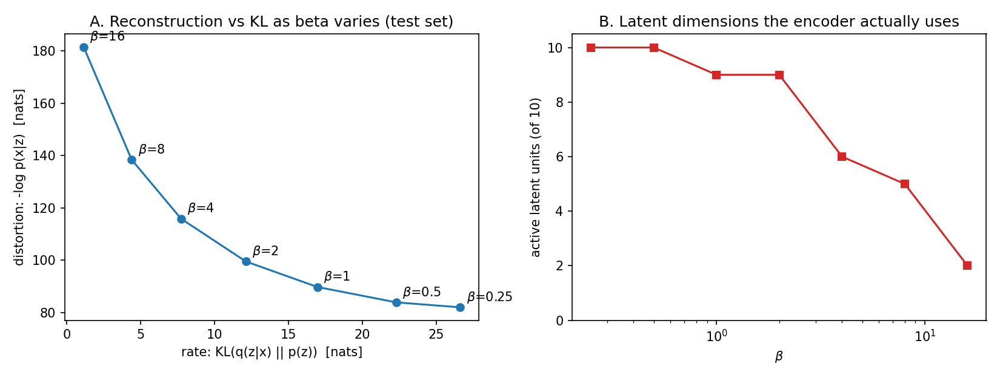
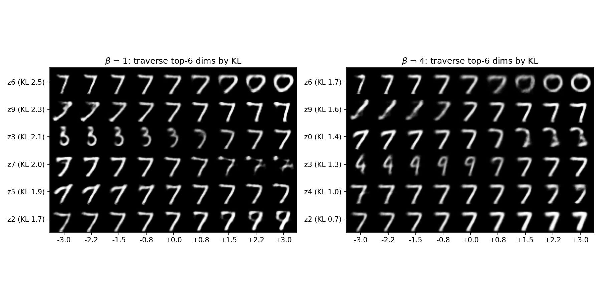

| beta | 0.25 | 0.5 | 1 | 2 | 4 | 8 | 16 |
|---|---|---|---|---|---|---|---|
| reconstruction NLL (nats) | 81.9 | 83.8 | 89.7 | 99.5 | 115.8 | 138.4 | 181.5 |
| KL (nats) | 26.6 | 22.3 | 17.0 | 12.1 | 7.7 | 4.4 | 1.1 |
| active units / 10 | 10 | 10 | 9 | 9 | 6 | 5 | 2 |

[Notes](04_vae/NOTES.md).

### 05 GAN: saturating vs non-saturating, and why Adam changes the answer
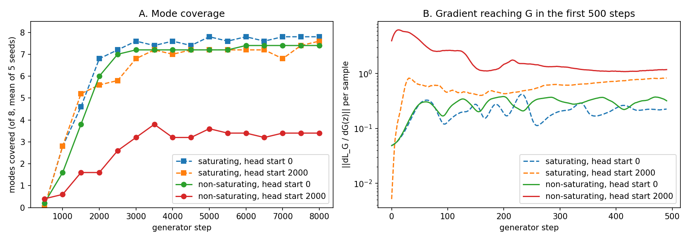
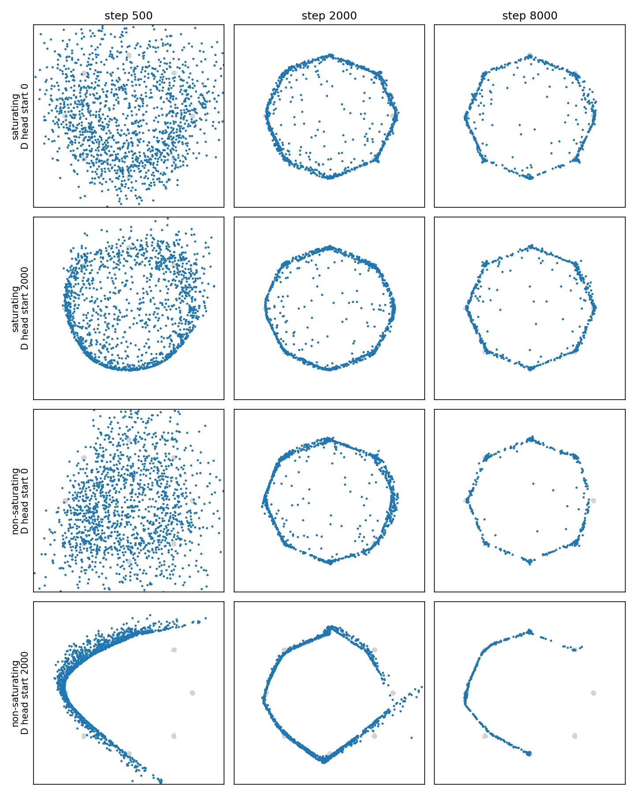

| G loss | D head start | Modes (of 8, mean of 5 seeds) | High-quality fraction |
|---|---|---|---|
| saturating | none | 7.8 | 0.71 |
| non-saturating | none | 7.4 | 0.81 |
| saturating | 2000 D steps | 7.4 | 0.60 |
| non-saturating | 2000 D steps | **3.4** | 0.84 |

[Notes](05_gan/NOTES.md).

### 06 DDPM: schedule matters when you cut sampling steps, and so does one line of the sampler
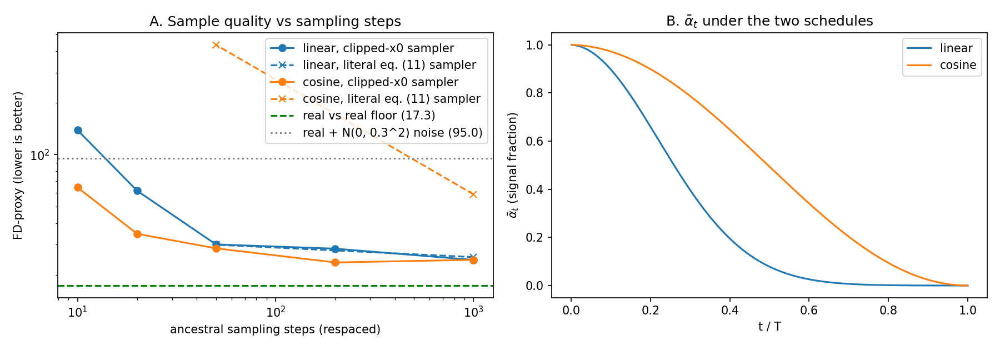
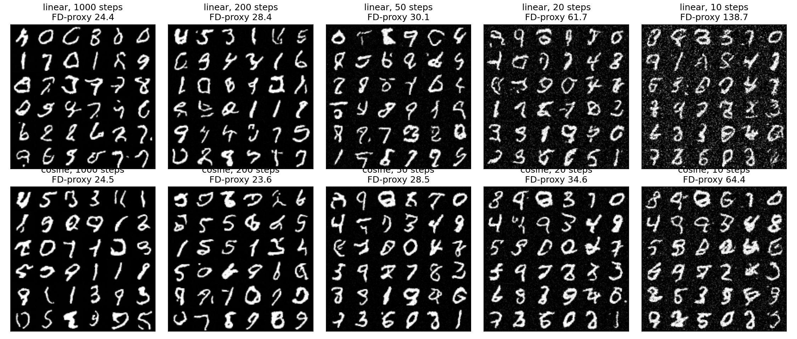

| Sampling steps | 1000 | 200 | 50 | 20 | 10 |
|---|---|---|---|---|---|
| linear schedule (FD-proxy) | 24.4 | 28.4 | 30.1 | 61.7 | 138.8 |
| cosine schedule (FD-proxy) | 24.5 | **23.6** | **28.5** | **34.6** | **64.4** |

FD-proxy = Frechet distance between 64-d features of a small MNIST CNN that we train ourselves. **It is a proxy, not FID.** The floor is 17.3 (real vs real at n = 500), and real images plus N(0, 0.3^2) pixel noise score 95.0. With the *literal* eq. (11) update, the cosine model scores 58.8 at 1000 steps and 434.8 at 50. Writing the same update in eq. (7) form with x0 clipped (as the paper's released code does) fixes it. [Notes](06_ddpm/NOTES.md).

## What's different here

The inspirations (below) are excellent implementation walkthroughs. This repo adds things they do not have:

1. **Every paper is tested, not just implemented.** Each folder runs an ablation aimed at the paper's *central claim* and reports a figure plus numbers. Several findings disagree with the folklore, or partly with the paper: bias correction is unnecessary at default betas, the non-saturating GAN loss collapses with a strong D under Adam, and deeper ResNets do not win on a short budget.
2. **A unified harness.** [`common/harness.py`](common/harness.py) gives every paper the same device/seed/thread setup, the same supervised loop, and the same `record()` call, which writes into one [`results/summary.csv`](results/summary.csv). Data loading ([`common/data.py`](common/data.py)) parses the raw IDX files directly, so torchvision is not needed.
3. **Parity checks against the reference library.** Our Adam vs `torch.optim.Adam` (9e-7), our BN vs `nn.BatchNorm2d` and our LN vs `F.layer_norm` (all within 1e-6) are run as part of the experiments, not left as an assumption.
4. **A NOTES.md per paper** with three sections: what the paper claims, what the ablation found at this scale, and where the two disagree and why. Cross-paper links are called out, e.g. Adam's scale invariance (01) is what rescues the saturating GAN loss (05).
5. **A reading map** that orders the papers by conceptual dependency.

## Caveats

- **Scale.** Everything is laptop-sized: MLPs and CNNs under 1M parameters, MNIST / Fashion-MNIST at 28x28, 2-8 epochs, 5,000 diffusion steps. CIFAR-10 was not used, to keep the total compute near 40 minutes. Effects that need long training (deeper ResNets overtaking shallower ones, DDPM sample quality at convergence) are not reproduced.
- **Seeds.** Papers 01-04 and 06 use a single seed. Paper 05 uses 5 seeds. Treat differences under about 1 point of accuracy, or a few FD-proxy units, as noise.
- **Metrics.** The FD-proxy in 06 is not FID and is not comparable to any published number. VAE nats are measured on grey-level (not binarised) MNIST, so they are not comparable to published likelihoods. The GAN mode-coverage thresholds (1% of samples, 3 std) are a convention.
- **Hyper-parameters** were set once from the papers' defaults and lightly swept where the ablation needed it (LR grids in 01 and 02). They were not tuned per method beyond that.
- **Runtime.** Paper 05 runs on CPU (2-D MLPs are faster there). The others run on Apple MPS with `torch.set_num_threads(2)`.

## Run it

```bash
pip install -r requirements.txt
python3 data/download.py            # MNIST + Fashion-MNIST IDX files (~60 MB, gitignored)
./run_all.sh                        # all six papers + figures/overview.png, ~40 min on M-series

# or one paper at a time
python3 -u 01_adam/train.py         # ~2 min
python3 -u 02_batchnorm/train.py    # ~7 min
python3 -u 03_resnet/train.py       # ~10 min  (--epochs, --n_train)
python3 -u 04_vae/train.py          # ~1.5 min (--epochs)
python3 -u 05_gan/train.py          # ~5-10 min, CPU (--steps, --seeds)
python3 -u 06_ddpm/train.py         # ~15 min  (--steps, --n_samples)
python3 make_overview.py
```

Each `train.py` writes `figures/*.png`, `results/results.json`, and its rows of `results/summary.csv`.

## Repository layout

```
common/          data.py (IDX loader), harness.py (loop, seeding, summary.csv)
data/download.py public-mirror downloader
01_adam/ ... 06_ddpm/
    model.py     the paper, equations cited inline
    train.py     the ablation
    NOTES.md     claim vs finding
    figures/ results/
results/summary.csv
```

## Roadmap

- [ ] 3-5 seeds for papers 01-04 and 06, with confidence intervals
- [ ] CIFAR-10 versions of 03 and 06, with longer schedules to test "deeper ResNets win" and real FID
- [ ] Add the Transformer (Vaswani et al.) between 02 and 06 in the reading map
- [ ] 05: WGAN-GP and unrolled-GAN baselines for the mode-collapse benchmark
- [ ] 06: DDIM sampling (Song et al. 2020) in the steps-vs-quality sweep

## References

Papers implemented
- Kingma & Ba, *Adam: A Method for Stochastic Optimization*, 2014. [arXiv:1412.6980](https://arxiv.org/abs/1412.6980)
- Ioffe & Szegedy, *Batch Normalization*, 2015. [arXiv:1502.03167](https://arxiv.org/abs/1502.03167)
- Ba, Kiros & Hinton, *Layer Normalization*, 2016. [arXiv:1607.06450](https://arxiv.org/abs/1607.06450)
- He, Zhang, Ren & Sun, *Deep Residual Learning for Image Recognition*, 2015. [arXiv:1512.03385](https://arxiv.org/abs/1512.03385)
- Kingma & Welling, *Auto-Encoding Variational Bayes*, 2013. [arXiv:1312.6114](https://arxiv.org/abs/1312.6114)
- Higgins et al., *beta-VAE*, ICLR 2017. [OpenReview](https://openreview.net/forum?id=Sy2fzU9gl)
- Goodfellow et al., *Generative Adversarial Nets*, 2014. [arXiv:1406.2661](https://arxiv.org/abs/1406.2661)
- Ho, Jain & Abbeel, *Denoising Diffusion Probabilistic Models*, 2020. [arXiv:2006.11239](https://arxiv.org/abs/2006.11239)
- Nichol & Dhariwal, *Improved Denoising Diffusion Probabilistic Models*, 2021. [arXiv:2102.09672](https://arxiv.org/abs/2102.09672)

Used for interpretation
- Santurkar et al., *How Does Batch Normalization Help Optimization?*, 2018. [arXiv:1805.11604](https://arxiv.org/abs/1805.11604)
- Arjovsky & Bottou, *Towards Principled Methods for Training GANs*, 2017. [arXiv:1701.04862](https://arxiv.org/abs/1701.04862)
- A 2025 re-examination of Adam's bias correction. [arXiv:2511.20516](https://arxiv.org/abs/2511.20516)
- Heusel et al., *GANs Trained by a Two Time-Scale Update Rule* (FID), 2017. [arXiv:1706.08500](https://arxiv.org/abs/1706.08500)

Inspirations (no code was copied; implementations were written from the papers)
- [labmlai/annotated_deep_learning_paper_implementations](https://github.com/labmlai/annotated_deep_learning_paper_implementations) inspired the scope of this repo: paper implementations with side-by-side equation notes.
- [The Annotated Transformer](https://github.com/harvardnlp/annotated-transformer) (Harvard NLP) inspired the scope of the "paper text next to code" format.
- [lucidrains](https://github.com/lucidrains)' minimal single-file repos inspired the scope of keeping each method in one small, readable file.

Data: [MNIST](https://storage.googleapis.com/cvdf-datasets/mnist/) (public mirror of LeCun et al.) and [Fashion-MNIST](https://github.com/zalandoresearch/fashion-mnist) (Xiao et al., 2017).

## License
MIT, see [LICENSE](LICENSE).
