# autograd-engine

**A tensor-valued reverse-mode automatic differentiation engine (core `tensor.py` is ~430 lines, heavily commented) in NumPy, with a small neural-network library on top. Every gradient is checked against PyTorch and against finite differences, and the repo also measures where naive numerics break and how fast the engine is.**

Scalar autograd engines, with one Python object per number, are good for teaching but too slow to train anything. This one works on whole arrays. A `Tensor` wraps an `np.ndarray`, each op records a vector-Jacobian product, and broadcasting is handled in the backward pass. So `x @ W + b` with a batch of 16k rows is three graph nodes, not 16k × 32 × 3.

```
grad/
  tensor.py      Tensor, the tape (topological sort), backward, unbroadcast, all primitive ops
  functional.py  relu/tanh/softmax/linear/layer_norm/dropout/mse/cross_entropy (+ deliberately naive versions)
  nn.py          Module, Parameter, Linear, Sequential, LayerNorm, Dropout, Embedding, losses, init schemes
  optim.py       SGD (momentum, Nesterov, weight decay), Adam, AdamW
  scalar.py      50-line scalar engine, used only as the timing baseline
  viz.py         computation-graph drawing with networkx + matplotlib (no graphviz binary)
gradcheck.py     finite-difference checker + the full gradient-check report
tests/           op_specs.py (one table of 48 op cases), test_ops.py, test_nn.py, run_all.py
experiments/     stability.py, timing.py
examples/        moons.py, digits.py, char_lm.py, draw_graph.py
```

## How reverse-mode AD works

A program like `L = mean(tanh(x @ W + b)^2)` is a chain of primitive ops. Running it builds a directed acyclic graph: leaves are inputs and parameters, and every other node is an op output. Reverse mode computes the **adjoint** `ḡ = ∂L/∂v` of every node `v` in one backward sweep:

1. **Forward.** Evaluate each op and store what its derivative will need (inputs, or its own output for `exp`/`tanh`/`sigmoid`).
2. **Tape.** Sort the graph topologically. `Tensor.tape()` does this with an iterative DFS, so 5,000-op chains do not hit Python's recursion limit (there is a test for this).
3. **Backward.** Seed `∂L/∂L = 1` and visit nodes in reverse order. Each node calls its *vector-Jacobian product* `vjp(ḡ_out) → (ḡ_in1, ḡ_in2, …)`. The engine adds contributions arriving at the same node from different paths (the multivariate chain rule).

The whole Jacobian is never built. For `matmul`, `vjp(G) = (G Wᵀ, xᵀ G)`, which costs about the same as the forward op. That is why reverse mode gets the gradient with respect to *all* parameters at a small constant multiple of one forward pass ([Baydin et al., 2018](https://arxiv.org/abs/1502.05767)).

**Broadcasting.** If `b` has shape `(2,)` and is added to a `(1, 2)` or `(N, 2)` array, the forward pass copies `b` along the batch axis. The adjoint of copying is summing. `unbroadcast()` sums the gradient over every axis that broadcasting created or stretched. It is called in exactly one place, inside `backward()`. That is why each op's backward rule can be a one-liner.

### Worked example (numbers from `examples/draw_graph.py`)

`x = [[1, −2]]`, `W = [[0.5, −1], [0.25, 0.75]]`, `b = [0.1, −0.2]`.

| step | forward value | backward (adjoint) |
|---|---|---|
| `z = x@W + b` | `[0.100, −2.700]` | `∂L/∂z = ∂L/∂h · (1 − h²) = [0.0987, −0.0177]` |
| `h = tanh(z)` | `[0.0997, −0.9910]` | `∂L/∂h = 2h / n = [0.0997, −0.9910]` (n = 2) |
| `L = mean(h²)` | `0.4960` | seed `1` |
| `b` (broadcast) | | `∂L/∂b = Σ_batch ∂L/∂z = [0.0987, −0.0177]` |
| `W` | | `∂L/∂W = xᵀ ∂L/∂z = [[0.0987, −0.0177], [−0.1974, 0.0355]]` |
| `x` | | `∂L/∂x = ∂L/∂z Wᵀ = [[0.0671, 0.0114]]` |

The script asserts that this hand derivation, the engine and PyTorch all agree. The tape it records is `b, W, x, xW, z, h, h², sum, L`. Read right to left, that is the backward order:

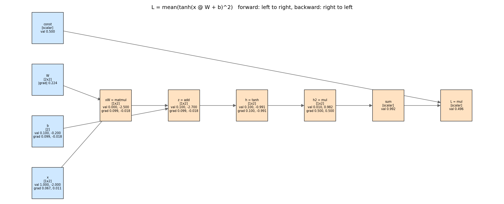

## API

```python
import numpy as np
from grad import Tensor, nn, optim
import grad.functional as F

model = nn.Sequential(nn.Linear(64, 128), nn.LayerNorm(128), nn.ReLU(),
                      nn.Dropout(0.2), nn.Linear(128, 10))
opt = optim.AdamW(model.parameters(), lr=1e-3, weight_decay=1e-2)
for xb, yb in batches:
    loss = F.cross_entropy(model(Tensor(xb)), yb)
    opt.zero_grad(); loss.backward(); opt.step()
```

### Ops (all gradient-checked; rules are in `grad/tensor.py`)

| op | backward rule (ḡ = upstream gradient) |
|---|---|
| `+  −  *  /` (broadcasting) | `ḡ`, `−ḡ`, `ḡ·b / ḡ·a`, `ḡ/b / −ḡ·a/b²`, then `unbroadcast` |
| `x ** p`, `x ** t` | `ḡ·p·x^(p−1)`; for a tensor exponent also `ḡ·out·log x` |
| `neg exp log tanh relu sigmoid` | `−ḡ`, `ḡ·out`, `ḡ/x`, `ḡ(1−out²)`, `ḡ·[x>0]`, `ḡ·out(1−out)` |
| `@` (2-D, batched, broadcast batch, vector) | `ḡ Bᵀ`, `Aᵀ ḡ`, unbroadcast over batch dims |
| `sum mean` (axis, keepdims) | expand `ḡ` back over the reduced axes |
| `max` (axis, keepdims) | `ḡ` to the argmax; ties split equally (same as `torch.amax`) |
| `softmax`, `log_softmax`, `logsumexp` | `s(ḡ − ⟨ḡ,s⟩)`, `ḡ − s·Σḡ`, `ḡ·s`; all max-shifted |
| `reshape transpose .T` | inverse reshape / inverse permutation |
| `x[idx]` (slices, fancy, repeated) | scatter with `np.add.at`, so repeated indices accumulate |
| `concatenate`, `stack` | split `ḡ` at the concatenation boundaries |

## Results

All numbers below come from scripts in this repo, run on an Apple-silicon Mac on CPU with BLAS and torch both limited to 2 threads.

### 1. Gradient check: 48 cases, 3 seeds each, float64 ([`results/gradcheck.csv`](results/gradcheck.csv))

Each op's output is contracted with a random tensor `R`, so one backward pass checks `Jᵀ R` (every Jacobian column with probability 1). The relative error is norm-wise: `max|g − ref| / max|ref|`. The table shows the worst case per op family.

| op | cases | max abs err vs PyTorch | max rel err vs PyTorch | max abs err vs FD | max rel err vs FD |
|---|---|---|---|---|---|
| add | 3 | 2.2e-16 | 8.3e-17 | 1.5e-09 | 7.1e-10 |
| sub | 2 | 4.4e-16 | 2.7e-16 | 3.8e-10 | 2.5e-10 |
| mul | 3 | 2.2e-16 | 9.7e-17 | 1.1e-09 | 4.0e-10 |
| div | 3 | 8.9e-16 | 3.2e-16 | 7.1e-10 | 3.2e-10 |
| pow | 3 | 8.9e-16 | 1.9e-16 | 4.8e-10 | 4.2e-10 |
| neg | 1 | 0 | 0 | 1.7e-10 | 7.5e-11 |
| matmul | 5 | 8.9e-16 | 1.7e-16 | 2.7e-09 | 6.0e-10 |
| sum / mean | 5 | 1.1e-16 | 1.6e-16 | 6.5e-10 | 3.9e-10 |
| max | 3 | 0 | 0 | 1.7e-10 | 1.1e-10 |
| exp / log / tanh / relu / sigmoid | 5 | 1.1e-16 | 1.7e-16 | 5.4e-10 | 2.6e-10 |
| softmax / log_softmax / logsumexp | 4 | 2.2e-16 | 4.0e-16 | 9.9e-10 | 1.3e-09 |
| reshape / transpose / getitem / concatenate | 8 | 0 | 0 | 3.7e-10 | 2.3e-10 |
| composites (LayerNorm, cross-entropy, tanh-MLP) | 3 | 2.7e-15 | 5.4e-16 | 1.2e-09 | 1.2e-09 |

Against PyTorch, the worst relative error over all 48 cases is **5.4e-16**, about 2.4 float64 ulps. Shape ops match bit for bit. Against central finite differences the worst is **1.3e-9**, which is the noise floor of FD at h = 1e-6 (see the V-curve below). The FD column measures the checker, not the engine. `tests/test_nn.py` also checks a whole MLP, Embedding with repeated ids, and SGD/Nesterov/Adam/AdamW trajectories over 25 steps against `torch.optim`. All match to < 1e-12.

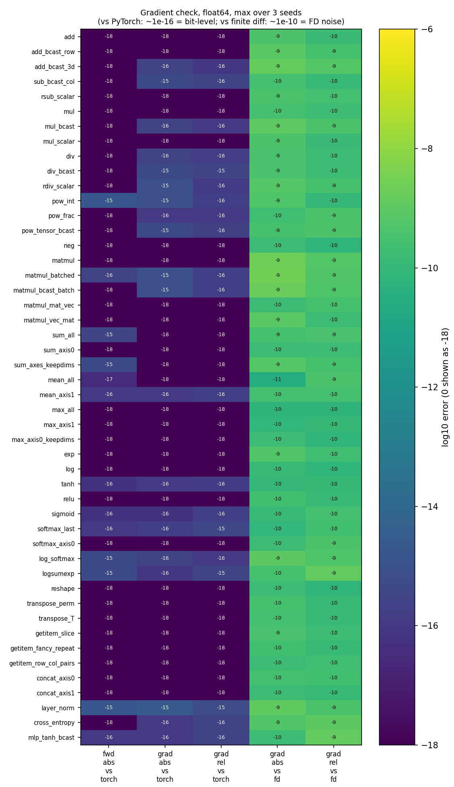

### 2. Numerical stability ([`experiments/stability.py`](experiments/stability.py))

**Softmax / cross-entropy as logits grow (float32, 512×10 logits).** The naive `−log(exp(x)/Σexp(x))` first returns inf/NaN loss at logit scale **23.7**. That is where the target probability underflows to 0, well before `exp` itself overflows at about 88. By scale 100, 93% of gradient entries are inf/NaN. The log-sum-exp version stays finite up to scale 10⁴, with worst relative error **7.2e-8** against a float64 reference and zero non-finite gradients.

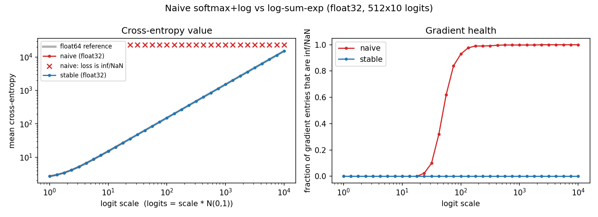

**Sigmoid saturation.** In float32, `1 − sigmoid(x)` rounds to exactly 0 for x ≥ **16.75**, so autograd returns a gradient of *exactly zero*, even though the true value is about 5e-8. In float64 this happens at x ≥ 36.75. In a 10-layer net, the layer-1 gradient of the sigmoid net is 3–5 orders of magnitude below tanh at every init gain, because σ′ ≤ 0.25 and that factor compounds over depth.

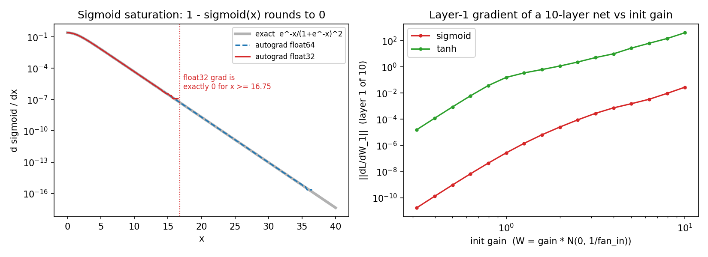

**Vanishing gradients vs depth** (30 layers, width 128, PyTorch-default `U(±1/√fan_in)` init, mean of 3 seeds):

| config | ‖∂L/∂W‖ at layer 1 | at layer 30 | layer 30 / layer 1 |
|---|---|---|---|
| tanh | 6.4e-08 | 3.2e-02 | 4.9e5 |
| sigmoid | **0 (layers 1–5 exactly zero)** | 2.5e-01 | ∞ |
| relu | 2.0e-12 | 1.9e-02 | 9.1e9 |
| relu, Kaiming-normal init | 1.15 | 6.95 | 6.0 |
| relu + LayerNorm (default init) | 0.83 | 2.67 | 3.2 |

The default init has std `1/√(3·fan_in)`, which is too small for a deep stack. Each layer shrinks the backward signal, and with sigmoid it underflows float32 entirely. Either fix keeps the ratio under 10×: the right init (Kaiming) or renormalising every layer (LayerNorm).

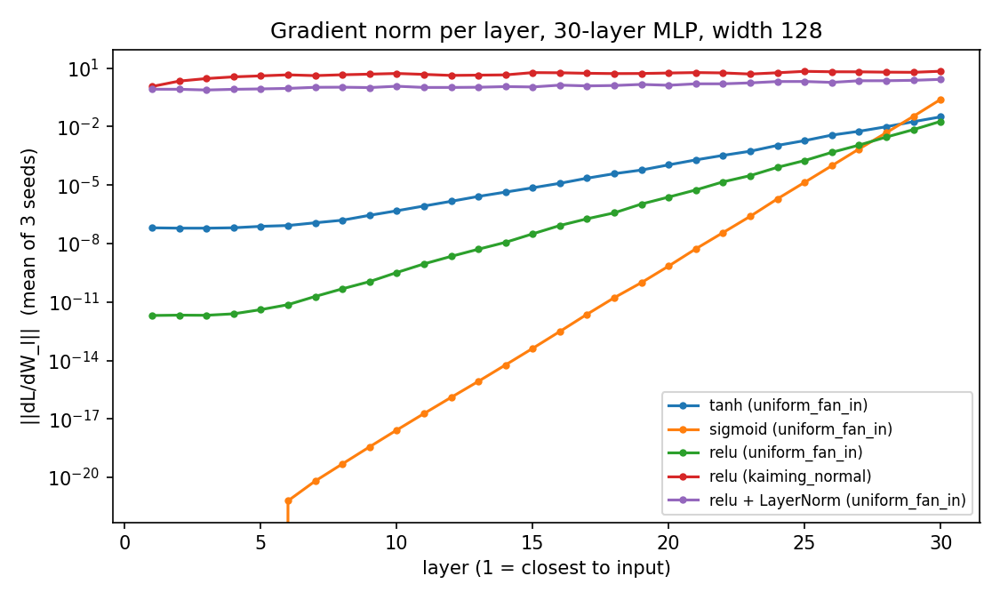

**Finite-difference error vs step size h** (24 coordinates of a small tanh/sigmoid net, against the verified autograd gradient):

| dtype | best central h | theory ε^(1/3) | best median error | best forward-difference h / error |
|---|---|---|---|---|
| float32 | 1.8e-2 | 4.9e-3 | 2.0e-6 | 1.0e-3 / 2.7e-5 |
| float64 | 1.0e-5 | 6.1e-6 | 2.8e-12 | 5.6e-8 / 1.6e-9 |

This is the classic V. On the right, truncation error grows as h² (central) or h (forward). On the left, round-off grows as ε/h. In float32, any h below about 1e-7 leaves `x + h == x`, so the estimate is exactly 0 and the error flattens at |g|. This is why `gradcheck.py` always works in float64 with h = 1e-6.

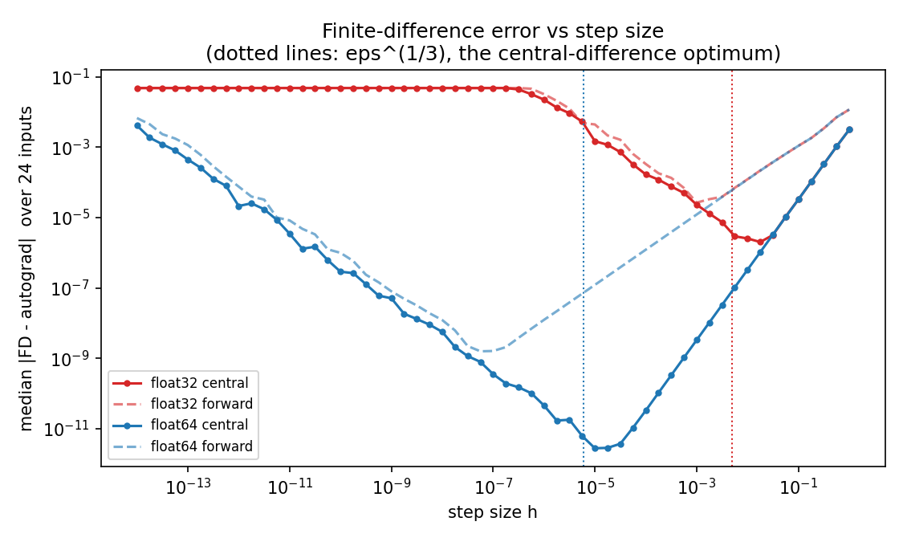

### 3. Performance ([`results/timing.csv`](results/timing.csv))

Forward + backward of the same 8-32-32-1 tanh MLP with MSE loss. Median wall time on CPU, 2 threads, float32.

| batch | grad (ms) | PyTorch CPU (ms) | scalar graph (ms) | grad / torch | scalar / grad |
|---|---|---|---|---|---|
| 1 | 0.108 | 0.066 | 4.1 | 1.6× | 38× |
| 16 | 0.110 | 0.090 | 101 | 1.2× | 917× |
| 64 | 0.118 | 0.085 | 581 | 1.4× | 4,900× |
| 256 | 0.151 | 0.194 | 2,624 | 0.8× | 17,400× |
| 1024 | 0.307 | 0.297 | n/a | 1.0× | n/a |
| 4096 | 0.839 | 0.798 | n/a | 1.05× | n/a |
| 16384 | 3.19 | 2.60 | n/a | 1.2× | n/a |

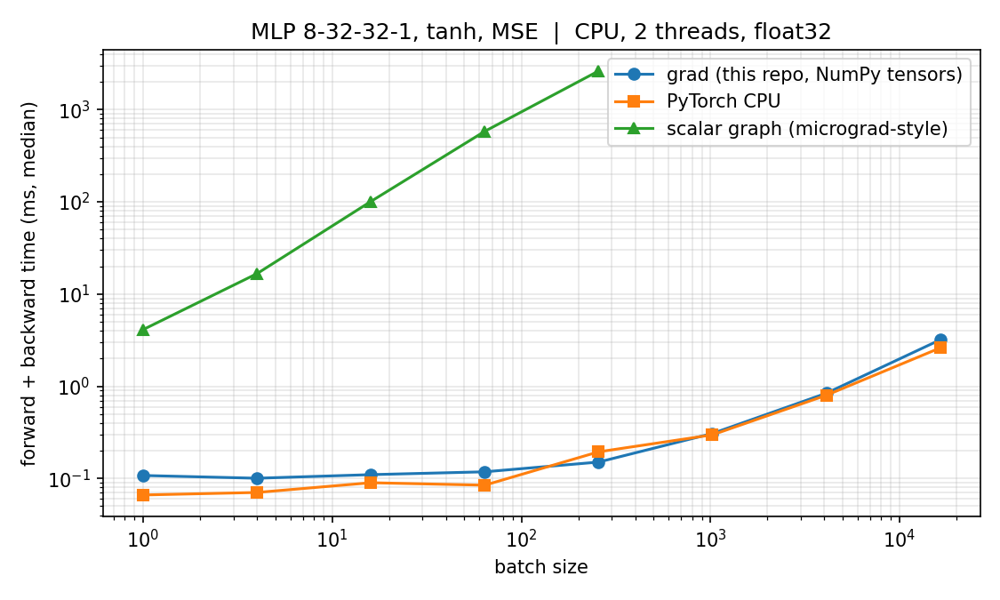

At small batch sizes, both tensor engines spend their time on per-op Python overhead, about 0.1 ms per step. Above about 1k rows both are bound by BLAS, and grad stays within 1.2× of PyTorch because it calls the same kind of matmul. The scalar engine grows linearly with the number of scalars and is **17,000× slower at batch 256**. That gap is the reason to vectorise. The batch-256 point where grad beats torch is within run-to-run noise and should not be read as a win.

### 4. Training with the engine

| task | model | result |
|---|---|---|
| two moons (sklearn, 1000 pts, noise 0.2) | 2-32-32-2 tanh MLP, 1,218 params, Adam, 600 steps | train acc 0.958, **test acc 0.945** |
| sklearn digits 8×8 (1,437 / 360 split) | 64-128-LN-ReLU-10, AdamW, 30 epochs | **test acc 0.9667**; PyTorch from identical init and batch order: 0.9667; per-epoch train-loss gap **6.7e-8** |
| same, with Dropout 0.2 | | test acc 0.9667 |
| Tiny Shakespeare, char level (65 symbols) | count bigram (closed form) | val NLL 2.493 nats/char |
| | neural bigram (65×65 logit table), 4,000 Adam steps | val NLL 2.500, converges to the count model |
| | MLP: 8-char context → Embedding 24 → 256 tanh → 65; 67,673 params, 20k steps, 27 s | **val NLL 1.671** |

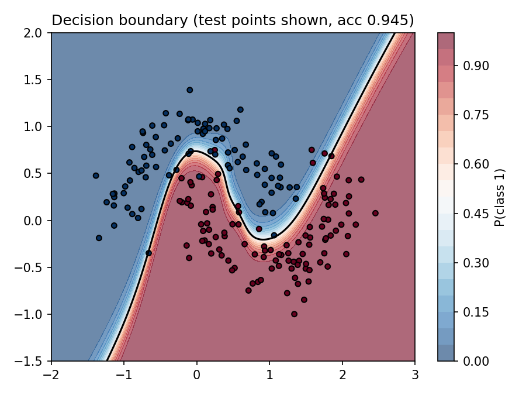
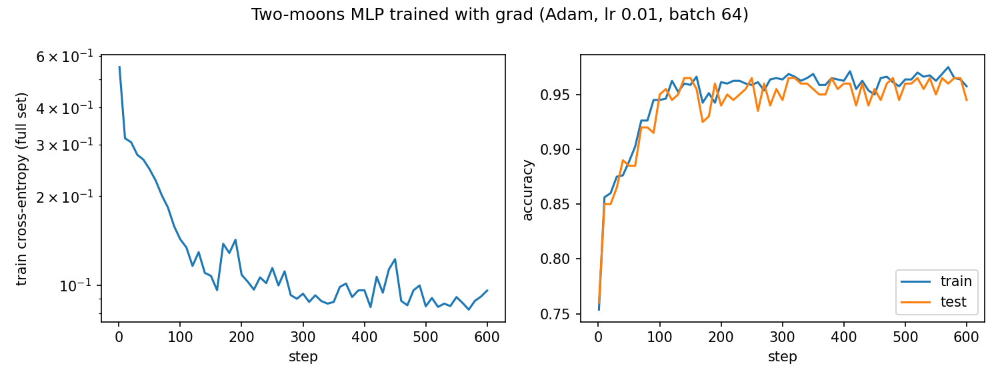
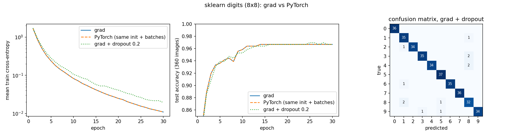
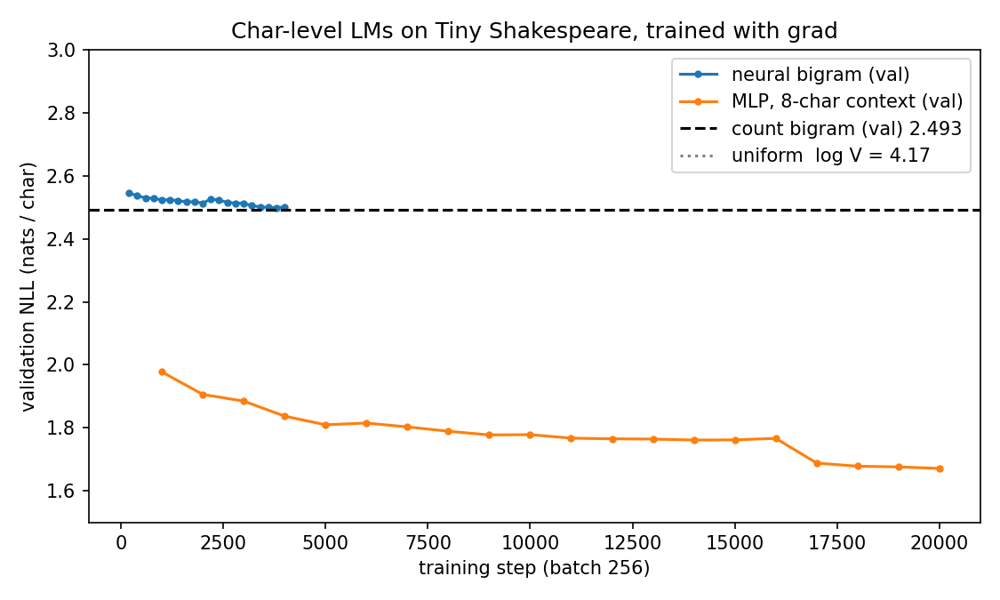

A sample from the char MLP ([`results/char_lm_samples.txt`](results/char_lm_samples.txt)):

```
GREMIO:
We will not kill they shall anggrant
To dream this catisfo, speak. But of your perciamateo's bring the may dament lords, go eess, restrone.
```

## What's different here

The projects that inspired this one (micrograd, the zero-to-hero lectures, early tinygrad) explain *how* to build autograd. This repo adds four things they do not have:

1. **A gradient-check table for every op**, against both PyTorch and float64 finite differences, with broadcasting, batched-matmul, repeated-index and composite cases, across 3 seeds. It is in `results/gradcheck.csv` and the heatmap. One shared spec file drives both the tests and the report, so they cannot drift apart.
2. **A numerical-stability study** with real failure points: naive cross-entropy dies at logit scale 23.7 in float32; float32 sigmoid gradients become exactly 0 at x = 16.75; per-layer gradient norms fall by up to 10¹⁰× over 30 layers with default init, and Kaiming init or LayerNorm fixes it; and the measured FD V-curve optimum lands within 2–4× of the theoretical ε^(1/3).
3. **A performance study** against PyTorch and a scalar graph on the same MLP and the same machine. It shows the tensor engine is within 1.2–1.6× of PyTorch on CPU at these sizes and 17,000× faster than a scalar engine at batch 256.
4. **End-to-end parity training.** On digits, grad and PyTorch start from the same weights and see the same batches. Their per-epoch losses stay within 6.7e-8 for 30 epochs, so optimiser, LayerNorm and cross-entropy are verified inside a real training loop, not just one step.

Design choices that differ from scalar engines: VJP closures *return* parent gradients rather than mutating them, the engine owns accumulation and broadcasting, the graph is freed after `backward()` unless `retain_graph=True`, and every module takes an explicit `np.random.Generator`.

## Caveats

- **CPU only, NumPy only.** There is no GPU path and no op fusion. Every op allocates a new array. The PyTorch comparison uses PyTorch on CPU with 2 threads, not MPS.
- **Timing is small-model timing.** One 8-32-32-1 MLP on one machine with 2 BLAS threads. At these sizes both engines are mostly measuring Python overhead. Medians of repeated runs still vary by about ±20% between runs, so the grad/torch ratios are approximate.
- **No higher-order gradients.** The backward pass works on raw arrays, not Tensors, so you cannot differentiate a gradient. There are also no in-place ops and no version counters.
- **`relu` and `max` are not differentiable everywhere.** The FD checks use inputs at least 0.2 away from relu's kink and inputs without ties for `max`. At ties, grad splits the gradient like `torch.amax`, which differs from `torch.max(dim)`.
- **Matmul FP warnings are silenced.** NumPy 2.0 with Apple Accelerate raises spurious divide/overflow flags in some matmuls whose outputs are finite and match PyTorch. Real overflow still shows up as inf.
- **One seed for the training examples** (3 seeds for the stability and gradcheck studies). Digits gets 0.9667 with and without dropout; the test set (360 images) is too small to separate them.
- The "naive" softmax and cross-entropy are written badly on purpose for the stability study. Do not use them.

## Run it

```bash
pip install -r requirements.txt
python3 tests/run_all.py          # 54 op tests + 9 nn/optim tests; exit code 1 on failure
python3 gradcheck.py              # results/gradcheck.csv + figures/gradcheck_heatmap.png (~5 s)
python3 experiments/stability.py  # 4 stability figures + CSVs (~2 s)
python3 experiments/timing.py     # timing table + log-log figure (~1 min)
python3 examples/draw_graph.py    # worked example + computation graph
python3 examples/moons.py         # ~2 s
python3 examples/digits.py        # grad vs PyTorch parity run (~5 s)
python3 examples/char_lm.py       # downloads Tiny Shakespeare (1.1 MB) into data/, ~30 s
```

## Roadmap

- [ ] Higher-order gradients by making VJPs operate on Tensors (Hessian-vector products, tested against `torch.autograd.functional.hvp`)
- [ ] A forward-mode (JVP) path and a measured forward-vs-reverse crossover as inputs vs outputs grow
- [ ] Conv2d via im2col, and a small CNN on digits
- [ ] Memory study: peak bytes vs depth, with and without gradient checkpointing
- [ ] Fused, numerically stable `sigmoid` gradient that avoids the float32 exact-zero at x > 16.75

## References

- A. G. Baydin, B. Pearlmutter, A. Radul, J. Siskind. *Automatic differentiation in machine learning: a survey*. JMLR 2018. [arXiv:1502.05767](https://arxiv.org/abs/1502.05767). This is the source for the forward/reverse-mode framing and the cost argument.
- PyTorch docs, [Autograd mechanics](https://pytorch.org/docs/main/notes/autograd.html), and the PyTorch blog's [Overview of the PyTorch autograd engine](https://pytorch.org/blog/overview-of-pytorch-autograd-engine/). These inspired the scope of the graph-freeing and gradient-accumulation semantics that grad matches.
- A. Karpathy, [micrograd](https://github.com/karpathy/micrograd). It inspired the scope of this project: an autograd engine plus a tiny NN library. grad is tensor-valued, and its scalar baseline in `grad/scalar.py` is written independently.
- A. Karpathy, [Neural Networks: Zero to Hero](https://karpathy.ai/zero-to-hero.html) and [makemore](https://github.com/karpathy/makemore). They inspired the scope of the char-level bigram → MLP language-model example.
- [tinygrad](https://github.com/tinygrad/tinygrad). Its early versions inspired the scope of a small tensor library with `nn` and `optim` on top.
- Finite-difference step size: the [FiniteDiff.jl notes on step selection](https://docs.sciml.ai/FiniteDiff/dev/epsilons/) and the standard truncation/round-off trade-off (optimal h ≈ ε^(1/3) for central differences).
- X. Glorot, Y. Bengio (2010), *Understanding the difficulty of training deep feedforward neural networks*; K. He et al. (2015), *Delving Deep into Rectifiers* ([arXiv:1502.01852](https://arxiv.org/abs/1502.01852)); J. Ba et al. (2016), *Layer Normalization* ([arXiv:1607.06450](https://arxiv.org/abs/1607.06450)). These cover the init schemes and LayerNorm.
- D. Kingma, J. Ba (2015), *Adam* ([arXiv:1412.6980](https://arxiv.org/abs/1412.6980)); I. Loshchilov, F. Hutter (2019), *Decoupled Weight Decay Regularization* ([arXiv:1711.05101](https://arxiv.org/abs/1711.05101)). These are the sources for the optimiser update rules.
- Data: scikit-learn `make_moons` and `load_digits`; Tiny Shakespeare from [karpathy/char-rnn](https://github.com/karpathy/char-rnn).
