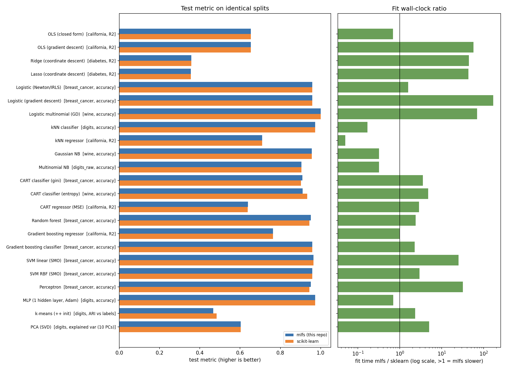
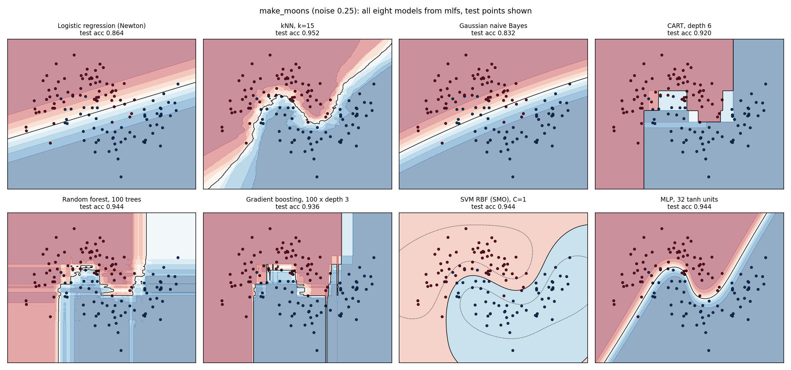
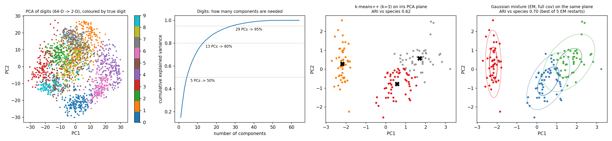
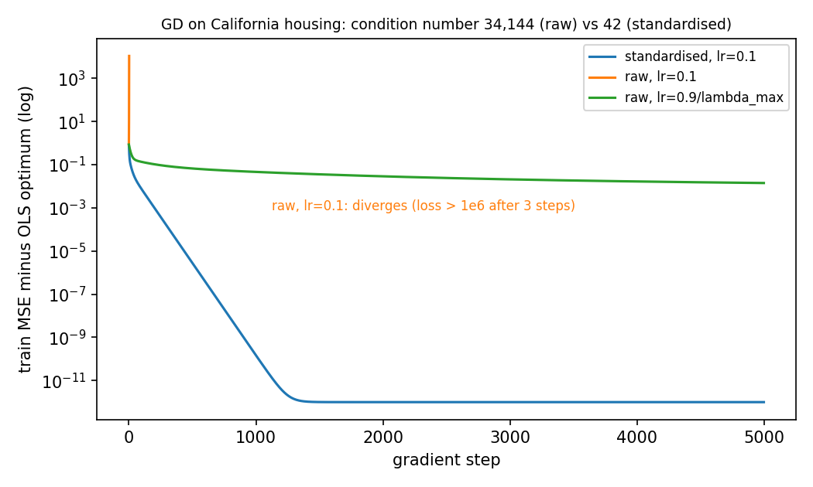
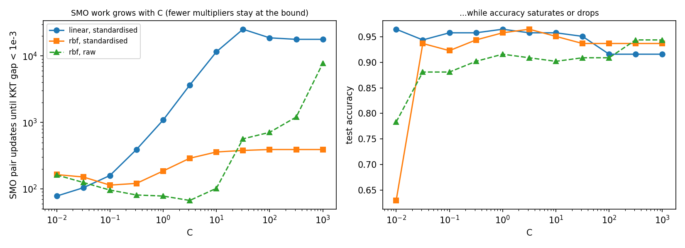
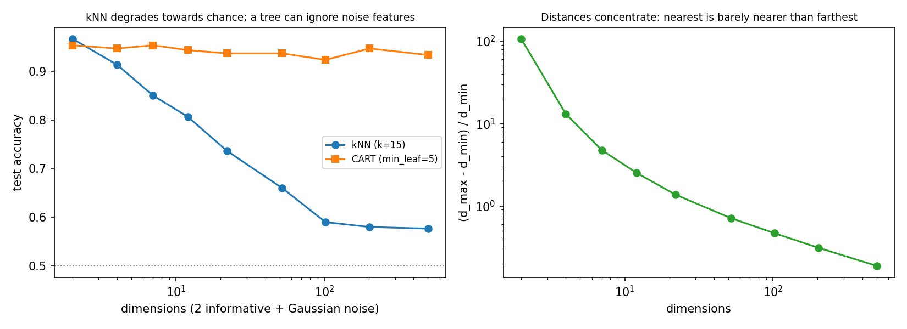
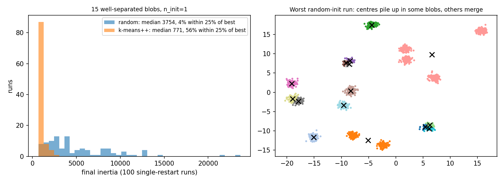
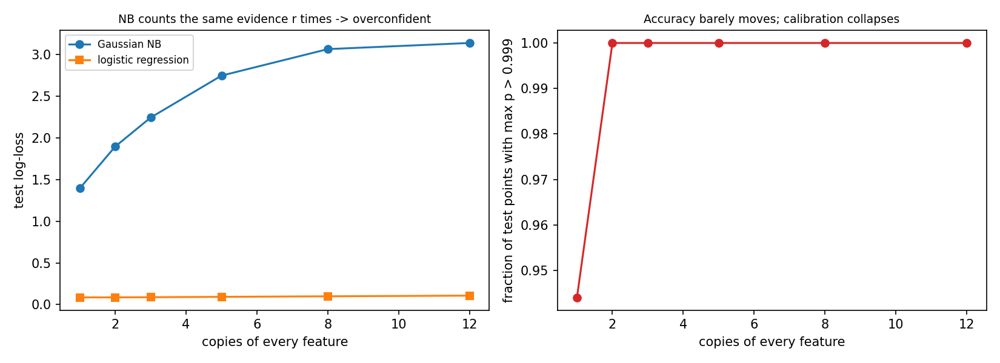
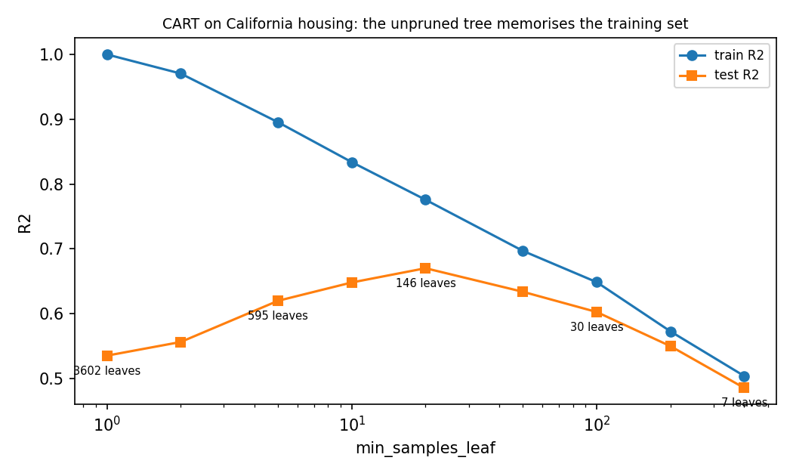
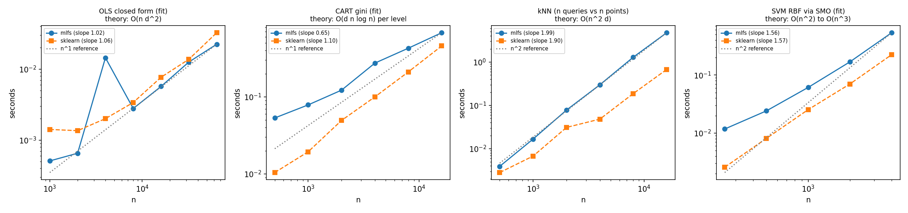

# classic-ml

**Twenty classic machine-learning estimators in about 1,500 lines of plain NumPy. They share one fit/predict API, a test suite checks each one against scikit-learn, and a benchmark scores every model next to its scikit-learn counterpart on the same data.**

Author: Abyn Scaria



There are plenty of "ML from scratch" repos. Most of them show that an algorithm *runs*, not that it gets the *right answer*, and they rarely show where the simple version breaks. This repo aims to be checkable:

- every estimator is compared with scikit-learn on the same split and the same hyperparameters, and the comparison is a test that can fail;
- six controlled experiments push the textbook implementations into their failure regimes;
- a timing study checks the measured fit-time scaling against the textbook complexity.

## API

Every model subclasses `mlfs.base.Estimator`. Hyperparameters are keyword arguments, `fit` returns `self`, and you get `get_params / set_params / clone` for free.

```python
import mlfs
from mlfs.datasets import load

d = load("breast_cancer")                      # fixed, stratified, standardised split
svm = mlfs.SVC(C=1.0, kernel="rbf").fit(d.X_train, d.y_train)
print(svm.score(d.X_test, d.y_test))           # 0.958, same as sklearn.svm.SVC
print(svm.n_iter_, svm.converged_)             # 186 SMO steps, True

gbm = mlfs.GradientBoostingClassifier(n_estimators=100).fit(d.X_train, d.y_train)
proba = gbm.predict_proba(d.X_test)            # (n, 2)

km = mlfs.KMeans(10, init="k-means++").fit(load("digits").X_train)
```

## What is implemented

| Algorithm | File | Math reference | sklearn counterpart | Parity check (tests/) |
|---|---|---|---|---|
| OLS: closed form (`lstsq`) and batch GD | [linear.py](mlfs/linear.py) | ESL 3.2 | `LinearRegression` | coef within 1e-8 |
| Ridge: closed form and coordinate descent | [linear.py](mlfs/linear.py) | ESL 3.4.1 | `Ridge` | coef within 1e-6 |
| Lasso: coordinate descent + soft-thresholding | [linear.py](mlfs/linear.py) | Friedman et al. 2010 | `Lasso` | coef within 1e-6, same zeros |
| Logistic regression: Newton/IRLS, GD, softmax GD | [logistic.py](mlfs/logistic.py) | PRML 4.3.3 | `LogisticRegression` (lbfgs) | coef within 1e-4, proba within 1e-5 |
| kNN classifier / regressor (brute force) | [knn.py](mlfs/knn.py) | ESL 13.3 | `KNeighbors*` | identical predictions |
| Gaussian and multinomial naive Bayes | [naive_bayes.py](mlfs/naive_bayes.py) | Murphy 3.5 | `GaussianNB`, `MultinomialNB` | proba within 1e-9 |
| CART: gini / entropy / MSE, `min_samples_leaf`, `max_features` | [tree.py](mlfs/tree.py) | ESL 9.2 | `DecisionTree*` | same depth, root split within 1e-6 |
| Random forest (bootstrap + feature subsampling) | [forest.py](mlfs/forest.py) | Breiman 2001 | `RandomForest*` | accuracy within 3 pts |
| Gradient boosting: L2 regression, binary log-loss with Newton leaves | [boosting.py](mlfs/boosting.py) | Friedman 2001, ESL Alg. 10.3 | `GradientBoosting*` | same init, ≥97% same labels |
| SVM via SMO, second-order working-set selection (linear / RBF / poly) | [svm.py](mlfs/svm.py) | Platt 1998; Fan, Chen & Lin 2005 | `SVC` (libsvm) | decision values within 2e-2, same #SV ±2 |
| k-means: Lloyd + k-means++ or random init, restarts | [kmeans.py](mlfs/kmeans.py) | Arthur & Vassilvitskii 2007 | `KMeans` | inertia within 0.5% |
| Gaussian mixture: EM, full covariances, log-space E-step, restarts | [gmm.py](mlfs/gmm.py) | PRML 9.2 | `GaussianMixture` | log-lik within 0.15 nats, monotone EM |
| PCA via SVD with deterministic sign | [pca.py](mlfs/pca.py) | PRML 12.1 | `PCA` | components within 1e-8 |
| Perceptron; 1-hidden-layer MLP with Adam | [neural.py](mlfs/neural.py) | PRML 5.3; Kingma & Ba 2015 | `Perceptron`, `MLPClassifier` | accuracy within 2 pts |
| Shared: `Estimator`, scaler, accuracy / R² / log-loss / ARI | [base.py](mlfs/base.py) | – | `sklearn.metrics` | within 1e-12 |
| Data: iris, wine, breast_cancer, digits, diabetes, California (5k rows), moons, blobs | [datasets.py](mlfs/datasets.py) | – | `sklearn.datasets` | – |

Where it mattered, objectives were written to match scikit-learn exactly: ridge uses `||y-Xw||² + α||w||²`, lasso uses `(1/2n)||y-Xw||² + α||w||₁`, logistic uses `½||w||² + C·Σ log-loss` with an unpenalised intercept, and GaussianNB uses the same `var_smoothing`. That way the parity checks compare coefficients and not only scores.

## What's different here

The repos listed under References inspired the scope. This one adds four things they do not have:

1. **A parity benchmark and a parity test suite.** `benchmark.py` fits 24 configurations in both libraries on identical splits with identical hyperparameters. For each it records the test metric, the agreement between the two models' predictions and the fit wall-clock, and writes them to [results/parity.csv](results/parity.csv). `tests/` turns those comparisons into assertions with explicit tolerances. They run with plain `python3`, no pytest needed.
2. **A failure-mode study** ([experiments/failure_modes.py](experiments/failure_modes.py)). It runs six experiments, each changing one variable, and each one has a figure and raw numbers in [results/failure_modes.json](results/failure_modes.json).
3. **A complexity study** ([experiments/timing.py](experiments/timing.py)). It measures fit/query time against n on log-log axes for 4 algorithms in both libraries and fits the empirical exponent.
4. **A different structure.** It is a flat package with one module per algorithm family and one base class, not supervised/unsupervised/deep-learning folders or notebooks. Every hyperparameter round-trips through `get_params`, and that is how the forest and the benchmark clone models.

## Results

All numbers below come from `benchmark.py`, `experiments/*.py` run on an Apple-silicon Mac (CPU only, `OMP_NUM_THREADS=2`, other jobs running at the same time). The split is 75/25, stratified for classification, with seed 0. Features are standardised with train-set statistics, except multinomial NB, which uses raw pixel counts.

### Parity with scikit-learn

"Agreement" is the fraction of identical test predictions for classifiers, ARI between the two labelings for clustering, `1 − mean|Δŷ|/std(y)` for regressors, and the minimum |cosine| between matched components for PCA.

| Algorithm | Data | Metric | mlfs | sklearn | Agreement | Fit time mlfs / sklearn |
|---|---|---|---|---|---|---|
| OLS closed form | california | R² | 0.6538 | 0.6538 | 1.000 | 0.69× |
| OLS gradient descent* | california | R² | 0.6538 | 0.6538 | 1.000 | 57× |
| Ridge (CD), α=1 | diabetes | R² | 0.3580 | 0.3580 | 1.000 | 45× |
| Lasso (CD), α=0.1 | diabetes | R² | 0.3561 | 0.3561 | 1.000 | 43× |
| Logistic Newton/IRLS | breast_cancer | acc | 0.958 | 0.958 | 1.000 | 1.6× |
| Logistic GD* | breast_cancer | acc | 0.958 | 0.958 | 1.000 | 169× |
| Logistic multinomial GD | wine | acc | 1.000 | 1.000 | 1.000 | 69× |
| kNN classifier, k=5 | digits | acc | 0.973 | 0.973 | 1.000 | (fit = store) |
| kNN regressor, k=10 | california | R² | 0.710 | 0.710 | 1.000 | (fit = store) |
| Gaussian NB | wine | acc | 0.956 | 0.956 | 1.000 | 0.32× |
| Multinomial NB | digits (raw) | acc | 0.904 | 0.904 | 1.000 | 0.32× |
| CART gini, unpruned | breast_cancer | acc | 0.909 | 0.902 | 0.965 | 3.6× |
| CART entropy, depth 4 | wine | acc | 0.911 | 0.933 | 0.956 | 4.8× |
| CART MSE, depth 8 | california | R² | 0.639 | 0.638 | 0.990 | 2.9× |
| Random forest, 100 trees | breast_cancer | acc | 0.951 | 0.944 | 0.993 | 2.4× |
| GBM regressor, 100×d3 | california | R² | 0.764 | 0.764 | 0.999 | 1.0× |
| GBM classifier, 100×d3 | breast_cancer | acc | 0.958 | 0.958 | 1.000 | 2.3× |
| SVM linear (SMO), C=1 | breast_cancer | acc | 0.965 | 0.965 | 1.000 | 25× |
| SVM RBF (SMO), C=1 | breast_cancer | acc | 0.958 | 0.958 | 1.000 | 2.9× |
| Perceptron, 50 epochs | breast_cancer | acc | 0.951 | 0.944 | 0.965 | 32× |
| MLP 64 ReLU, Adam | digits | acc | 0.973 | 0.973 | 0.984 | 0.70× |
| k-means++, k=10 | digits | ARI vs labels | 0.467 | 0.484 | 0.947 | 2.3× |
| GMM, 3 full-cov | iris | test log-lik | −2.138 | −2.226 | 1.000 | 0.81× |
| PCA, 10 PCs | digits | explained var | 0.6026 | 0.6026 | 1.000 | 5.0× |

\*scikit-learn has no full-batch GD solver, so these rows use the exact solution (`LinearRegression`, `LogisticRegression` lbfgs) as the reference. They show that GD *reaches* the optimum, not a like-for-like timing.

What this shows:

- **Exact parity (agreement 1.000)** for every model with a unique optimum or a deterministic rule: OLS, ridge, lasso, logistic, kNN, both NBs, the SMO SVMs and PCA. The SVM is the most convincing case. A hand-written SMO and libsvm stop at the same KKT tolerance and give the same support set (104 SVs for RBF) and the same test labels.
- **Small differences for the greedy or randomised models** (trees, forest, k-means, perceptron) come from tie-breaking and RNG streams, not bugs. With `max_depth=4`, the wine entropy tree picks a different but equally good split at one node, and that moves 2 of 45 test predictions. sklearn's k-means uses *greedy* k-means++ (several candidate seeds per step), which explains its slightly better ARI.
- **Speed.** Wherever the work is one BLAS call (OLS, NB, IRLS, MLP forward/backward), the NumPy version is within about 2× of sklearn or faster at this size. Python-level loops cost 3–170×: coordinate descent, the SMO inner loop and per-node tree splits.

### Decision boundaries (make_moons, noise 0.25)



All eight classifiers come from `mlfs`. Logistic regression and Gaussian NB are stuck with near-linear boundaries (0.864 and 0.832). kNN (0.952), the RBF SVM (0.944) and the tanh MLP (0.944) follow the moons smoothly. The tree, the forest and boosting draw axis-aligned staircases.

### Unsupervised views of real data



On raw digits, 13 principal components keep 80% of the variance and 29 keep 95%. On the iris PCA plane, k-means++ reaches ARI 0.62 against species. A full-covariance GMM reaches 0.70, but only as the best of 5 EM restarts. The five single-restart ARIs were 0.45, 0.70, 0.52, 0.70 and 0.52. In the bad runs EM splits setosa into two components and merges versicolor with virginica, which is why `GaussianMixture` has an `n_init` parameter.

## Failure-mode study

### 1. Gradient descent needs scaled features


| California housing, OLS by batch GD | condition no. of XᵀX/n | lr | excess train MSE after 5,000 steps |
|---|---|---|---|
| standardised | 42 | 0.1 | 1e-16 (machine precision by ~1,300 steps) |
| raw | 34,144 | 0.1 | diverges (loss > 1e6 within 3 steps) |
| raw | 34,144 | 0.9/λ_max = 0.0056 | 0.0142 (still 3% above optimum) |

GD only converges for lr < 2/λ_max, and the error along the smallest eigen-direction shrinks by (1 − lr·λ_min) per step. On raw features the largest-variance column (HouseAge, variance 160 vs 0.01 for AveBedrms) sets λ_max, so the safe step size is tiny and convergence is about κ = 34,000 times slower. Standardising cuts κ by about 800×.

### 2. SMO work grows with C


| breast_cancer | SMO steps at C=0.01 | C=1 | C=10 | C=1000 | test acc at C=1 → 1000 |
|---|---|---|---|---|---|
| linear kernel, standardised | 78 | 1,085 | 11,522 | 17,760 | 0.965 → 0.916 |
| RBF, standardised | 164 | 186 | 359 | 391 | 0.958 → 0.937 |
| RBF, raw features | 162 | 78 | 102 | 7,785 | 0.916 → 0.944 |

With small C most multipliers sit at the bound α=C and each pair update can clip immediately. With large C, multipliers become free and must be balanced against each other, so the KKT gap closes slowly. With the linear kernel, the iteration count grows 230× from C=0.01 to 1000 while test accuracy *drops*, a direct cost of the hard-margin limit on non-separable data. All runs converged (gap < 1e-3).

### 3. kNN in high dimension


| total dims (2 informative + noise) | 2 | 7 | 22 | 102 | 502 |
|---|---|---|---|---|---|
| kNN (k=15) test acc | 0.967 | 0.850 | 0.737 | 0.590 | 0.577 |
| CART (min_leaf=5) test acc | 0.953 | 0.953 | 0.937 | 0.923 | 0.933 |
| distance contrast (d_max − d_min)/d_min | 107 | 4.8 | 1.37 | 0.47 | 0.19 |

Euclidean distance weights every coordinate equally. Once 500 noise dimensions dominate the norm, the nearest training point is only 19% closer than the farthest, so "neighbours" carry almost no label information. A tree picks the informative features by impurity and barely notices the noise.

### 4. k-means: random seeding vs k-means++


On 15 well-separated blobs with 100 single-restart runs each, k-means++ gives a median inertia of 771, and 56% of runs land within 25% of the best inertia found (708). Uniform-random seeding gives a median of 3,754, and only 4% of runs land within 25%. Lloyd's algorithm cannot move a centre across empty space. When two seeds land in one blob, one blob ends up without a centre for good. Even k-means++ hits the true optimum (within 1%) in only 11% of runs, which is why restarts (`n_init`) are still needed.

### 5. Naive Bayes with correlated features


| copies of every breast_cancer feature | 1 | 2 | 5 | 12 |
|---|---|---|---|---|
| Gaussian NB accuracy | 0.909 | 0.909 | 0.909 | 0.909 |
| Gaussian NB test log-loss | 1.39 | 1.90 | 2.75 | 3.14 |
| logistic regression test log-loss | 0.086 | 0.086 | 0.092 | 0.107 |

Duplicating features multiplies NB's log-likelihood ratio by r, so the posterior saturates while the accuracy stays the same. Even at r=1, NB is already badly overconfident on this dataset: 94% of test points get max p > 0.999, and its log-loss is 16× worse than logistic regression. Radius, perimeter and area are close to deterministic functions of each other, so the dataset is already "duplicated". Logistic regression shares the weight across copies and is barely affected.

### 6. Decision tree overfitting


| min_samples_leaf | 1 | 5 | 20 | 100 | 400 |
|---|---|---|---|---|---|
| leaves | 3,602 | 595 | 146 | 30 | 7 |
| train R² | 1.000 | 0.895 | 0.776 | 0.648 | 0.504 |
| test R² | 0.535 | 0.620 | **0.670** | 0.602 | 0.485 |

The unpruned tree has nearly one leaf per training point (3,602 leaves for 3,750 rows) and memorises noise. Requiring 20 samples per leaf gives +0.135 test R². Past that point, bias dominates.

## Complexity study



Synthetic `make_classification` data with d = 20. The exponent is the slope of log t vs log n over the larger half of each grid ([results/timing.csv](results/timing.csv)).

| Algorithm | Theory | mlfs slope | sklearn slope | time at largest n (mlfs / sklearn) |
|---|---|---|---|---|
| OLS closed form | O(n d²) → 1 | 1.02 | 1.06 | 0.022 s / 0.032 s (n=64k) |
| CART gini, depth 8 | O(d n log n) per level → ~1.1 | 0.65 | 1.10 | 0.68 s / 0.46 s (n=16k) |
| kNN, n queries × n points | O(n² d) → 2 | 1.99 | 1.90 | 4.74 s / 0.67 s (n=16k) |
| SVM RBF via SMO | O(n²)–O(n³) | 1.56 | 1.57 | 0.53 s / 0.22 s (n=4k) |

OLS and kNN match theory closely. The mlfs tree's slope is below 1 (0.65 here, 0.88 on an earlier run of the same script) because, at these sizes, the per-node Python overhead (bounded by depth 8) still dominates the vectorised sorting; the slope is also the most sensitive to machine load. SMO comes in *below* the usual n² rule of thumb in both libraries. On this well-conditioned problem the number of pair updates grows sub-linearly in n, and the O(n²) kernel matrix is a single fast BLAS call. kNN is about 7× slower than sklearn's brute-force path because the neighbour sort (`argpartition` + `lexsort`) runs on the full n×n distance matrix.

## Caveats

- **Parity is checked on small, clean, public datasets** (112–3,750 training rows). Agreement at this scale says nothing about numerical robustness on ill-conditioned or huge data, where sklearn's solvers have years of hardening.
- **Wall-clock numbers are noisy.** Other jobs were running on the same machine and the fits are milliseconds long. Treat ratios as order-of-magnitude only. Fits under 1 s take the best of 3 repeats.
- **California housing**: 5,000 random rows, with `log1p` applied to AveRooms, AveBedrms, Population and AveOccup. Without it, a single block with AveOccup > 1,000 lands in the test split and gives OLS a test R² of −3.7 *in both libraries*. The transform is applied identically for every model.
- **Scope limits**: SVC, GBM classifier and perceptron are binary only. The multinomial logistic model uses GD, not Newton. No sample weights, no sparse input, no multi-output. The SVM precomputes the full kernel matrix, so memory is O(n²), which is why the timing grid stops at n=4,000. The trees use exhaustive sorted splits with no histogram binning.
- **The SMO solver uses the Fan–Chen–Lin (2005) working-set rule, not Platt's original two-loop heuristic**, because the former has a clean stopping criterion. It is written from the paper's equations, not from libsvm's source.
- Tolerances in `tests/` were chosen after looking at the results, and they are tight wherever the optimum is unique. Agreement numbers for random-seeded models (forest, k-means) are for one seed.

## Run it

```bash
pip3 install -r requirements.txt
python3 tests/run_all.py                 # 30 tests, 4-11 s depending on machine load
python3 benchmark.py                     # results/parity.csv, figures/parity.png
python3 experiments/failure_modes.py     # figures/fail_*.png, results/failure_modes.json
python3 experiments/timing.py            # figures/timing.png, results/timing.csv
python3 experiments/visualize.py         # decision_boundaries.png, unsupervised.png, results/visualize.json
```

The first call to `load("california")` downloads the dataset through scikit-learn and caches it in `~/scikit_learn_data`.

## Roadmap

- Multiclass SVM (one-vs-one) and Platt-scaled probabilities.
- Histogram-based split finding for trees, to see where binning closes the speed gap to sklearn.
- Elastic net and warm-started regularisation paths for the lasso.
- A failure-mode experiment for GMMs with singular covariances (`reg_covar = 0`).
- Kernel caching / shrinking in SMO, to remove the O(n²) memory limit.

## References

Textbooks
- C. M. Bishop, *Pattern Recognition and Machine Learning* (PRML), Springer 2006. [free PDF](https://www.microsoft.com/en-us/research/publication/pattern-recognition-machine-learning/)
- T. Hastie, R. Tibshirani, J. Friedman, *The Elements of Statistical Learning* (ESL), 2nd ed. [free PDF](https://hastie.su.domains/ElemStatLearn/)
- K. P. Murphy, *Machine Learning: A Probabilistic Perspective*, MIT Press 2012.

Papers
- J. Platt, [Sequential Minimal Optimization](https://www.microsoft.com/en-us/research/publication/sequential-minimal-optimization-a-fast-algorithm-for-training-support-vector-machines/), MSR-TR-98-14, 1998.
- R.-E. Fan, P.-H. Chen, C.-J. Lin, [Working Set Selection Using Second Order Information for Training SVM](https://www.jmlr.org/papers/v6/fan05a.html), JMLR 6, 2005.
- J. H. Friedman, [Greedy Function Approximation: A Gradient Boosting Machine](https://projecteuclid.org/journals/annals-of-statistics/volume-29/issue-5/Greedy-function-approximation-A-gradient-boosting-machine/10.1214/aos/1013203451.full), Annals of Statistics, 2001.
- L. Breiman, [Random Forests](https://link.springer.com/article/10.1023/A:1010933404324), Machine Learning 45, 2001.
- D. Arthur, S. Vassilvitskii, [k-means++: The Advantages of Careful Seeding](https://dl.acm.org/doi/10.5555/1283383.1283494), SODA 2007.
- J. Friedman, T. Hastie, R. Tibshirani, [Regularization Paths for GLMs via Coordinate Descent](https://www.jstatsoft.org/article/view/v033i01), J. Stat. Software, 2010.
- D. P. Kingma, J. Ba, [Adam: A Method for Stochastic Optimization](https://arxiv.org/abs/1412.6980), ICLR 2015.

Repos (scope only; no code taken)
- [eriklindernoren/ML-From-Scratch](https://github.com/eriklindernoren/ML-From-Scratch) inspired the scope of the algorithm list.
- [trekhleb/homemade-machine-learning](https://github.com/trekhleb/homemade-machine-learning) inspired the scope of pairing each algorithm with its math.
- [ddbourgin/numpy-ml](https://github.com/ddbourgin/numpy-ml) inspired the scope of a NumPy-only package with a consistent model interface.
- [rushter/MLAlgorithms](https://github.com/rushter/MLAlgorithms) inspired the scope of minimal, readable implementations.
- [scikit-learn](https://scikit-learn.org) is the reference implementation every parity number is measured against.
